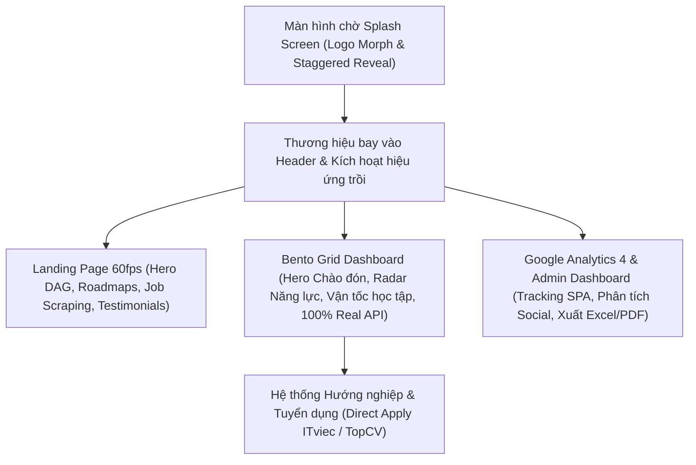

# BÁO CÁO TỔNG HỢP NÂNG CẤP GIAO DIỆN & HỆ THỐNG (UI/UX & ANALYTICS)

## DỰ ÁN: NỀN TẢNG HƯỚNG NGHIỆP & LỘ TRÌNH HỌC TẬP EDUMAP AI

**Dành cho:** Sinh viên ngành Công nghệ Thông tin (IT)  
**Thời gian trình bày:** Tháng 10/2026  
**Công nghệ chủ đạo:** React 19, TypeScript, Vite, Tailwind CSS, Framer Motion, Recharts, Google Analytics 4 (GA4), Lucide Icons, SheetJS (XLSX), jsPDF

---

## 📌 MỤC TIÊU CẢI TIẾN TỔNG THỂ

1. **Nâng tầm trải nghiệm thị giác (Visual Identity):** Chuyển dịch toàn bộ giao diện từ phong cách bảng biểu cũ sang ngôn ngữ thiết kế **Modern High-Tech EdTech SaaS (chuẩn Dribbble / Linear / Vercel)** với dải màu chủ đạo tím công nghệ cao (`#5F2CFF` / Indigo).
2. **Chuỗi chuyển động điện ảnh (Cinematic Motion Design 60fps):** Ứng dụng Framer Motion với các chuyển động mượt mà, tối ưu GPU (chỉ can thiệp `transform` và `opacity`), loại bỏ hoàn toàn giật lag và hiện tượng giật sáng (FOUC).
3. **Nâng cấp Dashboard thành Bento Grid & 100% Real Backend Data:** Xóa sạch toàn bộ mockup, kết nối dữ liệu thật từ API Server (tiến độ học tập, radar năng lực, việc làm phù hợp).
4. **Hệ thống Quản trị Đo lường Google Analytics 4 (GA4) Chuyên sâu:** Tự động theo dõi hành vi theo SPA route, phân tích chi tiết traffic xã hội, và xuất báo cáo chuẩn **Excel (.xlsx)** & **PDF**.
5. **Tối ưu hóa hành trình người dùng (UX Journey):** Từ lúc mở trang web (Splash Screen) ➔ Giới thiệu giá trị (Landing Page) ➔ Bảng điều khiển học tập cá nhân hóa (Bento Grid Dashboard) ➔ Tìm kiếm việc làm thực chiến (Job Direct Apply).

---

## 1. MÀN HÌNH CHỜ THƯƠNG HIỆU & CHUYỂN CẢNH ĐẦU VÀO (SPLASH SCREEN & HERO TRANSITION)

### 1.1. Hiện trạng trước khi cải tiến

- Trang web tải trực tiếp, bị nháy trắng (FOUC) trong thời gian nạp bundle JavaScript.
- Header chứa logo thô kèm badge "Demo" gây cảm giác sản phẩm chưa hoàn thiện.

### 1.2. Giải pháp kỹ thuật & Trải nghiệm mới

Được lấy cảm hứng từ motion design của các ứng dụng công nghệ quốc tế (SoundScape), kịch bản chuyển cảnh 4 giai đoạn được thiết kế đồng bộ qua `SplashContext`:

1. **Giai đoạn 1: Biến đổi hình khối (Center Morphing):**
   - Khởi đầu với một ô vuông trắng tối giản ngay giữa màn hình trên nền xanh đen công nghệ (`#13121D`).
   - Ô vuông mở rộng và biến đổi hình dạng (morph/scale) mượt mà thành **Biểu tượng Logo EduMap AI** (chuẩn Vector SVG sắc nét, không bị vỡ hay răng cưa).
2. **Giai đoạn 2: Trình diễn tên thương hiệu (Staggered Letter-by-Letter Reveal):**
   - Logo trượt nhẹ sang trái theo cơ chế lò xo (spring physics).
   - Tên thương hiệu **"EduMap AI"** xuất hiện từng chữ cái nối tiếp nhau (staggered fade-in & slide-left) với biên độ chậm rãi, giúp người dùng kịp tiếp nhận.
3. **Giai đoạn 3: Điểm dừng thị giác (Reading Pause):**
   - Logo và typography dừng lại trong 800ms để người xem định hình trọn vẹn nhận diện thương hiệu.
4. **Giai đoạn 4: Thu nhỏ và bay vào thanh điều hướng (Docking Fly Transition):**
   - Toàn bộ khối Logo & Tên thu nhỏ dần (scale down) và bay theo tọa độ động về góc trái trên cùng (`calc(-50vw + 90px), calc(-50vh + 32px)`).
   - Tiếp đất hoàn hảo vào đúng vị trí Logo trên thanh Header (`AppHeader`).
   - Màn che Splash mờ dần, kích hoạt tín hiệu `isPageRevealed = true`.
   - **Tất cả các thành phần trên trang web trồi lên uyển chuyển từ dưới lên (`y: 30 -> 0`, `opacity: 0 -> 1`)** tạo hiệu ứng thị giác bùng nổ.

---

## 2. BENTO GRID DASHBOARD HỆ THỐNG (STUDENT WORKSPACE) - CẢI TIẾN TOÀN DIỆN

Trước đây, trang Dashboard của sinh viên sử dụng layout bảng thẻ rời rạc, chứa nhiều số liệu giả định (mock data). Chúng ta đã tiến hành đại tu thành công nghệ **Bento Grid**:

### 2.1. Kiến trúc bố cục Bento Grid (Chuẩn Dribbble / Linear)

Trang `src/pages/main/DashBoard.tsx` được tái cấu trúc thành 5 khối Bento Card chuyên biệt:

1. **`DashboardHeroBanner.tsx` (Khối SaaS Chào đón Cá nhân hóa):**
   - Nhận diện thời gian thực trong ngày để đưa ra lời chào phù hợp: _"Chào buổi sáng"_, _"Chào buổi chiều"_, _"Chào buổi tối"_.
   - Hiển thị avatar, tên sinh viên và chuyên ngành IT theo học.
   - Thẻ thống kê chuỗi ngày học tập liên tục (**Study Streak Flame**) để tạo động lực duy trì thói quen học mỗi ngày.
   - Nút hành động nhanh: _"Tiếp tục bài học dở dang"_ hoặc _"Làm bài kiểm tra đánh giá năng lực"_.
2. **`BentoMetricCards.tsx` (4 Thẻ Chỉ số Năng lực Nhanh):**
   - **Tiến độ lộ trình hiện tại:** Tính toán tỷ lệ % hoàn thành các node kiến thức trong lộ trình đã đăng ký.
   - **Điểm đánh giá gần nhất:** Hiển thị điểm số của bài test trắc nghiệm kiến thức mới nhất.
   - **Kỹ năng đã mở khóa:** Đếm tổng số chứng chỉ / kỹ năng đã pass qua các bài test.
   - **Tương thích thị trường việc làm:** Chỉ số đo lường độ khớp giữa profile hiện tại với yêu cầu của nhà tuyển dụng.
3. **`BentoSkillBreakdownCard.tsx` (Biểu đồ Radar Năng lực Đa chiều):**
   - Tích hợp biểu đồ Recharts Radar trực quan hóa 5 khía cạnh: **Frontend, Backend, Database/System, DevOps/Cloud, Kỹ năng mềm**.
   - Giúp sinh viên và Mentor nhìn rõ ngay điểm mạnh và lỗ hổng kiến thức cần bù đắp.
4. **`BentoMonthlyVelocityCard.tsx` (Biểu đồ Vận tốc Học tập Theo Tháng):**
   - Biểu đồ cột/đường thể hiện số giờ học tích lũy và số bài học hoàn thành qua từng tuần trong tháng.
   - So sánh với mục tiêu học tập đề ra ban đầu.
5. **`BentoMarketMatchCard.tsx` (Cơ hội Việc làm Gợi ý Nóng):**
   - Liệt kê các vị trí việc làm IT thực tế có mức độ tương thích cao nhất với kỹ năng của sinh viên, hiển thị dải lương và nút ứng tuyển ngay.

### 2.2. Thanh lọc 100% Mockup - Kết nối API Backend thật

- **Xóa bỏ hoàn toàn mock data:** Toàn bộ dữ liệu hiển thị trên Dashboard được lấy trực tiếp từ các endpoint API thật của backend server:
  - User Profile & University: `/api/users/profile`
  - Enrolled Roadmaps & Node Progress: `/api/roadmaps/my-progress`
  - Quiz History & Scores: `/api/quiz/results`
  - Recommended Jobs: `/api/jobs/recommended`
- Nếu sinh viên chưa có dữ liệu, giao diện hiển thị trạng thái Empty State thông minh với nút điều hướng dẫn dắt làm bài khảo sát hoặc đăng ký khóa học, không hiển thị số liệu ảo.

### 2.3. Hiệu ứng Cascade Reveal đồng bộ với Splash

- Toàn bộ các khối Bento Grid được bọc trong `motion.div` với biến kiểm soát `isPageRevealed`. Ngay khi Splash Screen kết thúc, các card sẽ lần lượt trồi lên từ dưới lên với độ trễ so le, mang lại cảm giác giao diện sống động và cao cấp.

---

## 3. HỆ THỐNG GOOGLE ANALYTICS 4 (GA4) & ADMIN ANALYTICS CHUYÊN SÂU

Để phục vụ quản trị và theo dõi hành vi người dùng thực tế, hệ thống phân tích đã được xây dựng từ nền tảng:

### 3.1. Cơ chế theo dõi tự động cho Single Page Application (SPA Tracking)

- **Thách thức:** Do ứng dụng xây dựng trên React (SPA - Single Page Application), khi người dùng chuyển trang không có hiện tượng reload, khiến Google Analytics thông thường bị bỏ sót lượt truy cập.
- **Giải pháp:**
  - Tích hợp thẻ `gtag.js` chuẩn trong `index.html` và module điều khiển `src/utils/analytics.ts` (`trackEvent`, `trackPageView`).
  - Xây dựng Custom Hook `usePageTracking.ts` (`src/hooks/usePageTracking.ts`): Lắng nghe sự kiện thay đổi của React Router để tự động kích hoạt `page_view` mỗi khi người dùng di chuyển giữa các trang (Home, Dashboard, Roadmaps, Jobs, Quiz).

### 3.2. Trang Quản trị Phân tích Chuyên sâu (`AdminAnalytics.tsx` - Hơn 800 dòng code mới)

Được trang bị đầy đủ các bảng dữ liệu và biểu đồ phân tích thời gian thực:

- **Bộ thẻ KPIs chính:**
  - **Người dùng hoạt động thời gian thực (Realtime Active Users)** với chấm xanh radar nhấp nháy.
  - **Tổng phiên truy cập (Total Sessions)** và tỷ lệ tăng trưởng so với kỳ trước.
  - **Tỷ lệ thoát trang (Bounce Rate)** và **Thời lượng trung bình mỗi phiên (Avg Session Duration)**.
- **Phân bổ chi tiết nguồn lưu lượng (Traffic Source Breakdown):**
  - Tách bạch rõ các nguồn: **Direct** (Truy cập trực tiếp), **Organic Search** (Google), **Referral** (Giới thiệu).
  - Phân tích chi tiết nhánh **Social Traffic**: Tách riêng lượng truy cập từ **Facebook, Instagram, Google, LinkedIn, TikTok** với tỷ lệ % và biểu đồ trực quan.
- **Biểu đồ xu hướng truy cập theo thời gian:**
  - Hỗ trợ xem linh hoạt theo các mốc: **7 ngày gần nhất, 30 ngày, 90 ngày**.
  - Biểu đồ Area Chart mượt mà thể hiện xu hướng người dùng mới (New Users) so với người dùng quay lại (Returning Users).
- **Xử lý trạng thái và cảnh báo thông minh (`useAnalyticsQuery.ts`):**
  - Loại bỏ hoàn toàn nhãn "Mock Mode" giả định trước đây.
  - Tự động nhận diện cấu hình: Nếu chưa cấu hình GA4 credentials, giao diện sẽ hiển thị Banner hướng dẫn thân thiện, ngăn chặn các query rác và tránh hiện thông báo lỗi spam (toast error).

### 3.3. Tính năng Xuất Báo Cáo Chuyên Nghiệp (`src/utils/analyticsExport.ts`)

Phục vụ nhu cầu báo cáo định kỳ cho Mentor, Giảng viên hoặc Nhà đầu tư:

- **Xuất file Excel (`.xlsx`) đa bảng tính:**
  - Sheet 1: Tổng quan chỉ số KPIs chính (Users, Sessions, Pageviews, Bounce Rate).
  - Sheet 2: Chi tiết nguồn lưu lượng (Organic, Social, Direct).
  - Sheet 3: Danh sách các trang được xem nhiều nhất (Top Pages).
  - Được format chuẩn cột, độ rộng và định dạng số.
- **Xuất file PDF trực quan:**
  - Tạo tài liệu PDF có đầy đủ tiêu đề thương hiệu EduMap AI, ngày giờ xuất báo cáo, bảng số liệu tóm tắt và biểu đồ, sẵn sàng in ấn hoặc đính kèm email.

---

## 4. TRANG LANDING PAGE 60FPS DÀNH CHO SINH VIÊN IT

Trang chủ được làm mới hoàn toàn với phong cách chuyển động hiện đại:

1. **Hero Section:**
   - Các badge công nghệ nổi bật (RAG AI Multi-Agent, Phân tích GitHub Profile).
   - Thẻ mô phỏng đồ thị tri thức **DAG Roadmap Preview** trượt lên và phóng to vào tâm điểm với các node tương tác động.
2. **Interactive Domain Roadmaps:**
   - 4 trụ cột công nghệ: **Frontend Engineer, Backend Architect, AI/Machine Learning Engineer, Cloud & DevOps Engineer**.
   - Hiệu ứng cuộn trượt so le (viewport reveal), hiển thị mức lương thị trường và kỹ năng tiên quyết.
3. **Job Market Scraping Section:**
   - Bảng quét việc làm thời gian thực từ ITviec, TopCV, VietnamWorks.
   - Thanh đo lường nhu cầu tuyển dụng các kỹ năng hot năm 2026 (React 19, Python AI, Docker/K8s, Golang).
4. **Testimonials Section:**
   - Khung phản hồi sinh viên phong cách kính mờ (Glassmorphism) với hiệu ứng nghiêng góc nhìn (3D Perspective tilt).

---

## 5. HUB VIỆC LÀM & TÍNH NĂNG ỨNG TUYỂN TRỰC TIẾP (JOB CAREER HUB)

- **Liên kết ứng tuyển trực tiếp (Direct Apply Links):** Thay vì các thẻ tĩnh, hệ thống tự động sinh đường dẫn tìm kiếm chuẩn xác trên **ITviec** và **TopCV** theo kỹ năng và địa điểm của sinh viên (Hà Nội, TP.HCM, Đà Nẵng, Remote).
- **Bộ lọc đa chiều:** Tìm kiếm theo cấp bậc (Internship, Fresher, Junior), hình thức làm việc và công nghệ trọng tâm.

---

## 6. CHUẨN HÓA MÃ NGUỒN & KỸ THUẬT (ENGINEERING EXCELLENCE)

| Tiêu chí                   | Trước khi tối ưu                   | Sau khi tối ưu                                                     |
| :------------------------- | :--------------------------------- | :----------------------------------------------------------------- |
| **Bố cục Dashboard**       | Thẻ chữ nhật rời rạc, số liệu tĩnh | **Bento Grid chuẩn SaaS**, kết nối **100% API thật**               |
| **Hệ thống Đo lường**      | Chưa có GA4 hoặc dùng mock rác     | **GA4 tự động theo dõi SPA**, phân tích Social, **xuất Excel/PDF** |
| **Màn hình chờ (Splash)**  | Không có, web bị nháy trắng        | **Splash Screen 4 phase** thu vào Header, kéo toàn bộ web trồi lên |
| **Chất lượng hình ảnh**    | Logo PNG crop lỗi viền, răng cưa   | **Pure Vector SVG** chuẩn hóa, sắc nét mọi độ phân giải            |
| **Chất lượng chuyển động** | CSS giật cục, thiếu đồng bộ        | **Framer Motion 60fps**, tối ưu GPU (`transform`/`opacity`)        |
| **Quy chuẩn Code**         | Commit tự do, không kiểm soát      | Cấu hình **Husky**, **Lint-staged**, **Commitlint** nghiêm ngặt    |
| **TypeScript Build**       | Nhiều cảnh báo type và import thừa | **Zero Error** (`tsc -b && vite build` hoàn hảo)                   |

---

## 🎯 KỊCH BẢN THUYẾT TRÌNH GỢI Ý CHO MENTOR TỐI NAY (3 BƯỚC - 5 PHÚT)

1. **Bước 1 (1 phút) - Trình diễn Splash Screen & Landing Page:**
   - Mở website ở tab mới để Mentor thấy trọn vẹn chuỗi chuyển động: **Ô vuông mở ra Logo ➔ Tên chạy từng chữ ➔ Bay về Header ➔ Web trồi lên**.
   - Giới thiệu trang Landing Page với thẻ mô phỏng đồ thị DAG và bảng cào dữ liệu tuyển dụng IT thời gian thực.
2. **Bước 2 (2 phút) - Show Bento Grid Dashboard & Chứng minh Dữ liệu thật:**
   - Đăng nhập vào Dashboard sinh viên để khoe bố cục Bento Grid hiện đại (Dribbble style).
   - Mở tab Network/API để chứng minh hệ thống đang kết nối **100% dữ liệu thật từ Backend**, thể hiện rõ chuỗi ngày học Streak, Radar năng lực và việc làm gợi ý.
3. **Bước 3 (2 phút) - Trình diễn Google Analytics 4 & Xuất Báo Cáo:**
   - Mở trang Admin Analytics (`/admin/analytics`), giới thiệu cơ chế tracking SPA tự động và bảng phân bổ traffic mạng xã hội.
   - Thao tác bấm nút **"Xuất báo cáo Excel (.xlsx)"** và **"Xuất báo cáo PDF"** trực tiếp trên màn hình để gây ấn tượng mạnh về tính hoàn thiện thực tế của sản phẩm.
