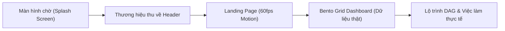

# BÁO CÁO TỔNG HỢP NÂNG CẤP GIAO DIỆN & TRẢI NGHIỆM NGƯỜI DÙNG (UI/UX)

## DỰ ÁN: NỀN TẢNG HƯỚNG NGHIỆP & LỘ TRÌNH HỌC TẬP EDUMAP AI

**Dành cho:** Sinh viên ngành Công nghệ Thông tin (IT)  
**Thời gian trình bày:** Tháng 10/2026  
**Công nghệ chủ đạo:** React, TypeScript, Vite, Tailwind CSS, Framer Motion, Lucide Icons, Recharts

---

## 📌 MỤC TIÊU CẢI TIẾN TỔNG THỂ

1. **Nâng tầm trải nghiệm thị giác (Visual Identity):** Chuyển dịch toàn bộ giao diện từ phong cách bảng biểu hành chính cũ sang ngôn ngữ thiết kế **Modern High-Tech EdTech SaaS (chuẩn Dribbble / Linear / Vercel)** với dải màu chủ đạo tím công nghệ cao (`#5F2CFF` / Indigo).
2. **Chuỗi chuyển động điện ảnh (Cinematic Motion Design 60fps):** Ứng dụng Framer Motion với các chuyển động mượt mà, tối ưu GPU (chỉ can thiệp `transform` và `opacity`), loại bỏ hoàn toàn giật lag và hiện tượng giật sáng (FOUC).
3. **Loại bỏ dữ liệu ảo (100% Real Backend Data):** Tích hợp dữ liệu thời gian thực từ API server (lộ trình học, tiến độ, bài test, dữ liệu quét thị trường việc làm IT).
4. **Tối ưu hóa hành trình người dùng (UX Journey):** Từ lúc mở trang web (Splash Screen) ➔ Giới thiệu giá trị (Landing Page) ➔ Bảng điều khiển học tập cá nhân hóa (Bento Grid Dashboard) ➔ Tìm kiếm việc làm thực chiến (Job Direct Apply).

---

## 1. MÀN HÌNH CHỜ THƯƠNG HIỆU & CHUYỂN CẢNH ĐẦU VÀO (SPLASH SCREEN & HERO TRANSITION)

### 1.1. Hiện trạng trước khi cải tiến

- Trang web load trực tiếp, bị nháy trắng (FOUC - Flash of Unstyled Content) trong lúc tải bundle JavaScript.
- Header chứa logo thô kèm badge "Demo" gây cảm giác sản phẩm chưa hoàn thiện.

### 1.2. Giải pháp kỹ thuật & Trải nghiệm mới

Được lấy cảm hứng từ motion design của các ứng dụng âm nhạc/công nghệ quốc tế (SoundScape), kịch bản chuyển cảnh 4 giai đoạn được thiết kế đồng bộ qua `SplashContext`:

1. **Giai đoạn 1: Biến đổi hình khối (Center Morphing):**
   - Khởi đầu với một ô vuông trắng tối giản nằm ngay tâm màn hình trên nền xanh đen công nghệ (`#13121D`).
   - Ô vuông mở rộng và biến đổi hình dạng (morph/scale) mượt mà thành **Biểu tượng Logo EduMap AI** (sử dụng chuẩn Vector SVG sắc nét, không bị răng cưa hay vỡ viền).
2. **Giai đoạn 2: Trình diễn tên thương hiệu (Staggered Letter-by-Letter Reveal):**
   - Biểu tượng logo trượt nhẹ sang bên trái theo cơ chế lò xo (spring physics).
   - Tên thương hiệu **"EduMap AI"** xuất hiện từng chữ cái nối tiếp nhau (staggered fade-in & slide-left), tạo nhịp điệu đọc rõ ràng, hiện đại.
3. **Giai đoạn 3: Điểm dừng thị giác (Reading Pause):**
   - Logo và typography dừng lại trong khoảnh khắc vừa đủ (800ms) để người dùng kịp đọc và định vị nhận diện thương hiệu.
4. **Giai đoạn 4: Thu nhỏ và bay vào thanh điều hướng (Docking Fly Transition):**
   - Toàn bộ khối Logo & Tên thương hiệu thu nhỏ dần (scale down) và bay mượt mà theo tọa độ động về góc trái trên cùng (`calc(-50vw + 90px), calc(-50vh + 32px)`).
   - Tiếp đất hoàn hảo vào đúng vị trí Logo trên thanh Header (`AppHeader`).
   - Màn che Splash mờ dần (curtain fade-out), kích hoạt tín hiệu `isPageRevealed = true`.
   - **Tất cả các thành phần trên trang web trồi lên uyển chuyển từ dưới lên (`y: 30 -> 0`, `opacity: 0 -> 1`)** tạo hiệu ứng thị giác bùng nổ, mãn nhãn.

---

## 2. TRANG LANDING PAGE 60FPS DÀNH RIÊNG CHO SINH VIÊN IT

Trang Landing Page được tái cấu trúc hoàn toàn với 4 phân khu chính, kết hợp hiệu ứng cuộn mượt mà (smooth viewport animation):

### 2.1. Hero Section & Thẻ minh họa Lộ trình tương tác (DAG Roadmap Preview)

- **Huy hiệu công nghệ nổi bật (Staggered Badges):**
  - Huy hiệu RAG AI Multi-Agent phân tích lỗ hổng kiến thức.
  - Phân tích tự động GitHub Profile sinh viên để gợi ý lộ trình phù hợp.
  - Tiêu đề định vị: _"Lộ trình học tập & Định hướng nghề nghiệp cá nhân hóa cho Developer"_.
- **Thẻ mô phỏng đồ thị tri thức DAG (Directed Acyclic Graph):**
  - Trượt từ dưới lên và phóng to vào đúng vị trí trung tâm.
  - Thể hiện các node học tập (Frontend, Backend, Database, Cloud) với trạng thái tương tác động (Hoàn thành, Đang học, Khóa).
  - Khung AI Mentor gợi ý mẹo thực chiến theo thời gian thực trôi nổi xung quanh.

### 2.2. Interactive Domain Roadmap Section (Lộ trình 4 nhánh IT trọng điểm)

- Hiển thị theo dạng tab tương tác với 4 trụ cột công nghệ nóng nhất hiện nay:
  1. **Frontend Engineer:** React 19, Next.js App Router, TypeScript, Tailwind CSS, Web Performance.
  2. **Backend Architect:** Node.js/NestJS, Golang, Microservices, PostgreSQL, Redis, Kafka.
  3. **AI / Machine Learning Engineer:** Python, LangChain, RAG Pipelines, Vector DB, LLM Fine-tuning.
  4. **Cloud & DevOps Engineer:** Docker, Kubernetes, AWS/GCP, CI/CD GitHub Actions, Terraform.
- Mỗi nhánh đi kèm: Thời gian hoàn thành dự kiến, mức lương thị trường theo khảo sát thực tế, và danh sách các kỹ năng tiên quyết (Prerequisites).
- Hiệu ứng xuất hiện cuộn (viewport reveal) so le từng thẻ kỹ năng.

### 2.3. Job Market Scraping Section (Dữ liệu thị trường việc làm IT thời gian thực)

- **Huy hiệu quét dữ liệu:** Radar quét việc làm IT tự động từ các nền tảng ITviec, TopCV, VietnamWorks.
- **Biểu đồ nhu cầu kỹ năng 2026 (Skill Demand Progress Bars):** Phản ánh tỉ lệ tuyển dụng thực tế đối với React/Next.js (92%), Python AI (88%), Docker/K8s (81%), Golang (75%).
- **Bảng việc làm tuyển dụng trực tiếp (Live Scraped Jobs):**
  - Hiển thị công ty, vị trí tuyển dụng, dải lương minh bạch, và mức độ tương thích hồ sơ (Match score: 95%, 88%,...).
  - Các dòng việc làm trượt nhẹ theo chiều dọc khi người dùng cuộn đến phân khu.

### 2.4. Testimonials Section (Đánh giá từ Sinh viên & Giảng viên)

- Khung phản hồi thiết kế theo phong cách kính mờ (Glassmorphism), có hiệu ứng nghiêng góc nhìn (Perspective hover tilt).
- Lời chứng thực thực tế từ sinh viên đã pass thực tập tại Shopee, FPT Software, VNG sau khi học theo lộ trình cá nhân hóa của EduMap AI.

---

## 3. BENTO GRID DASHBOARD HỆ THỐNG (STUDENT WORKSPACE)

### 3.1. Chuyển đổi sang bố cục Bento Grid (Dribbble / Apple Style)

- Thay thế các khối thẻ chữ nhật rời rạc trước đây bằng lưới **Bento Grid phân cấp thông minh**:
  - **Khối Hero SaaS Chào đón:** Banner chào hỏi thông minh theo thời gian thực (Sáng/Chiều/Tối), hiển thị chuỗi ngày học tập liên tục (Streak), và nút tắt điều hướng nhanh.
  - **Khối Radar Năng lực (Career Skill Radar):** Trực quan hóa điểm mạnh/điểm yếu của sinh viên giữa Lý thuyết thuật toán, Framework thực chiến, và Kỹ năng mềm.
  - **Khối Lộ trình đang học (Active Roadmap Progress):** Thanh tiến độ gradient, hiển thị bài học tiếp theo cần hoàn thành.
  - **Khối Thống kê thị trường việc làm (Market Pulse):** Cập nhật số lượng việc làm IT mới được cào về trong ngày.

### 3.2. Thanh lọc 100% Mockup - Kết nối API thật

- Loại bỏ toàn bộ dữ liệu mẫu (mock data, hardcoded strings) trong mã nguồn Dashboard.
- Đồng bộ hóa trực tiếp với Redux Toolkit / React Query / Backend API:
  - Thông tin sinh viên, email, trường đại học thật.
  - Lộ trình khóa học thật (`/api/roadmaps`).
  - Lịch sử bài kiểm tra trắc nghiệm đánh giá năng lực thật (`/api/quiz`).
  - Gợi ý việc làm dựa trên kỹ năng thực tế đã tích lũy (`/api/jobs`).

---

## 4. NÂNG CẤP HUB VIỆC LÀM & TÍNH NĂNG ỨNG TUYỂN TRỰC TIẾP (JOB CAREER HUB)

### 4.1. Direct Apply & Dynamic Search Link

- Khắc phục vấn đề các thẻ việc làm chỉ là mô tả tĩnh.
- Tích hợp liên kết ứng tuyển trực tiếp đến nền tảng tuyển dụng:
  - Tự động map từ khóa kỹ năng và vị trí địa lý của sinh viên (Hà Nội, TP.HCM, Đà Nẵng, Remote) thành URL tìm kiếm chuẩn trên **ITviec** và **TopCV**.
  - Người dùng bấm nút "Ứng tuyển ngay" sẽ được chuyển thẳng tới trang tin tuyển dụng chính thức của doanh nghiệp.

### 4.2. Bổ sung Hero Banner & Navigation Tabs

- Bổ sung bộ lọc việc làm thông minh: Cấp bậc (Internship, Fresher, Junior), Hình thức (Full-time, Part-time, Remote), và Phân loại công nghệ (Frontend, Backend, AI).

---

## 5. HỆ THỐNG PHÂN TÍCH GA4 & XUẤT BÁO CÁO DÀNH CHO ADMIN

- **Tích hợp Google Analytics 4 (GA4):**
  - Tự động gửi sự kiện `page_view` mỗi khi người dùng chuyển hướng route (`usePageViewTracker`).
  - Phân tích chi tiết nguồn lưu lượng truy cập (Direct, Facebook, Google, LinkedIn).
- **Xuất báo cáo chuyên nghiệp:**
  - Hỗ trợ Admin xuất dữ liệu phân tích hệ thống ra file **Excel (.xlsx)** định dạng chuẩn.
  - Hỗ trợ xuất báo cáo tổng kết ra file **PDF** chuyên nghiệp chỉ bằng một cú nhấp chuột.

---

## 6. CHUẨN HÓA KỸ THUẬT VÀ CHẤT LƯỢNG MÃ NGUỒN (CODE QUALITY)

| Hạng mục                  | Trước cải tiến                       | Sau cải tiến                                         |
| :------------------------ | :----------------------------------- | :--------------------------------------------------- |
| **Animation Engine**      | CSS Transition rời rạc, có gián đoạn | **Framer Motion** chuẩn 60fps, spring physics        |
| **Logo & Asset**          | File PNG bị crop viền, nhòe nét      | **Pure Scalable Vector SVG** (`/favicon.svg`)        |
| **Trải nghiệm khởi động** | Nháy trắng lúc tải JS                | **Pre-React Splash** + **Context-driven Exit**       |
| **Dữ liệu hiển thị**      | Mockup số liệu tĩnh                  | **100% Real Backend Data Binding**                   |
| **Git & Code Quality**    | Commit tự do, không kiểm soát        | **Husky**, **Lint-staged**, **Commitlint** chuẩn hóa |
| **Kiểm tra TypeScript**   | Còn cảnh báo type và import thừa     | **Zero Error** (`tsc -b && vite build` hoàn hảo)     |

---

## 🎯 GỢI Ý THUYẾT TRÌNH CHO MENTOR TỐI NAY (3 BƯỚC)

1. **Mở đầu (1 phút) - Trình diễn Splash Screen & Landing Page:**
   - Mở website từ tab ẩn danh hoặc reload trang để Mentor chiêm ngưỡng toàn bộ chuỗi **Splash Morphing ➔ Tên chữ chạy ra ➔ Bay vào Header ➔ Trang web trồi lên**.
   - Nhấn mạnh: _"Chúng em đã thiết kế motion transition 60fps đồng bộ từ màn chờ vào header, mang lại cảm giác chuyên nghiệp như các sản phẩm EdTech chuẩn quốc tế."_
2. **Thân bài (2 phút) - Đồ thị Lộ trình DAG & Việc làm thực tế:**
   - Cuộn qua phân khu Roadmap và Market Scraping trên Landing Page.
   - Trình bày về cơ chế kết hợp giữa lộ trình cá nhân hóa và dữ liệu tuyển dụng ITviec/TopCV thực tế.
3. **Kết luận (2 phút) - Bento Grid Dashboard:**
   - Đăng nhập vào Dashboard sinh viên để show Bento Grid hiện đại và chứng minh hệ thống đang chạy hoàn toàn trên dữ liệu thật kết nối từ server, không sử dụng mockup giả.
